# Manuel utilisateur de PicPlan

Ce manuel décrit les principales opérations dans PicPlan pour les administrateurs, les participants et les intervenants. Les noms de certains boutons peuvent varier légèrement selon la langue choisie dans l’application.

## Sommaire

- [Accéder à PicPlan](#accéder-à-picplan)
- [Préparer un événement (administrateur)](#préparer-un-événement-administrateur)
- [Gérer les profils associés à un événement](#gérer-les-profils-associés-à-un-événement)
- [Créer les lieux et les créneaux](#créer-les-lieux-et-les-créneaux)
- [Réserver un créneau (participant)](#réserver-un-créneau-participant)
- [Traiter les demandes (intervenant)](#traiter-les-demandes-intervenant)
- [Modifier son profil](#modifier-son-profil)
- [Résoudre les problèmes courants](#résoudre-les-problèmes-courants)

## Accéder à PicPlan

Ouvrez l’adresse de PicPlan fournie par votre organisation.

- **Administrateur** : ouvrez **Administration**, puis connectez-vous avec le mot de passe administrateur.
- **Participant ou intervenant** : ouvrez **Espace participant**, puis choisissez **Se connecter avec Discord**. L’adresse e-mail vérifiée du compte Discord doit correspondre à celle enregistrée sur votre profil PicPlan. Le compte doit également posséder le rôle Discord configuré pour son type de profil.

Après connexion, un profil ne peut accéder qu’aux événements auxquels l’administrateur l’a associé.

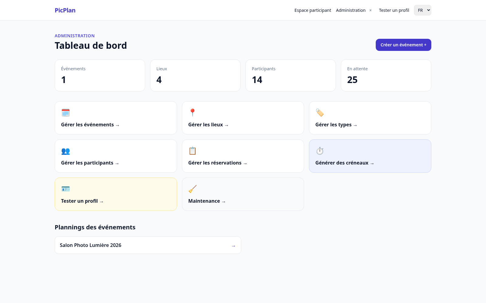

## Préparer un événement (administrateur)

Effectuez les opérations dans cet ordre pour qu’un événement soit prêt à recevoir des demandes.

### 1. Créer les types de profils

Dans **Administration → Gérer les types**, créez les types nécessaires, par exemple « Participant » et « Photographe ».

Pour chaque type, indiquez s’il correspond à un **intervenant**. Si la connexion Discord est utilisée, renseignez aussi l’identifiant du rôle Discord correspondant. Les utilisateurs devront posséder ce rôle pour accéder à un profil de ce type.

### 2. Créer l’événement

Dans **Administration → Gérer les événements**, créez l’événement et renseignez son titre, ses dates et ses limites :

- **Limite quotidienne de réservations** : nombre maximal de demandes actives d’un participant pour une journée.
- **Nombre maximal de demandes en attente par créneau** : capacité de la file d’attente d’un créneau. Le nombre maximal de refus est égal à cette limite moins un.
- **Autoriser plusieurs réservations chez le même intervenant par jour** : permet ou non à un participant de demander plusieurs créneaux auprès du même intervenant le même jour.

Vous pouvez modifier ces paramètres depuis la page de modification de l’événement. Un événement fermé n’accepte plus de nouvelles réservations ; un administrateur peut le rouvrir.

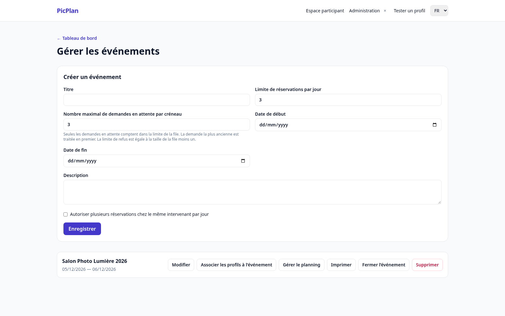

### 3. Créer les profils

Dans **Administration → Gérer les participants**, créez un profil avec son nom et son type. L’adresse e-mail est nécessaire pour associer le profil lors de la première connexion Discord. Vous pouvez également ajouter un avatar, une biographie, un lien social et jusqu’à 10 photos au mini-book.

Le formulaire permet d’associer directement le nouveau profil à un événement. Cette sélection est facultative et peut être modifiée depuis le planning de l’événement.

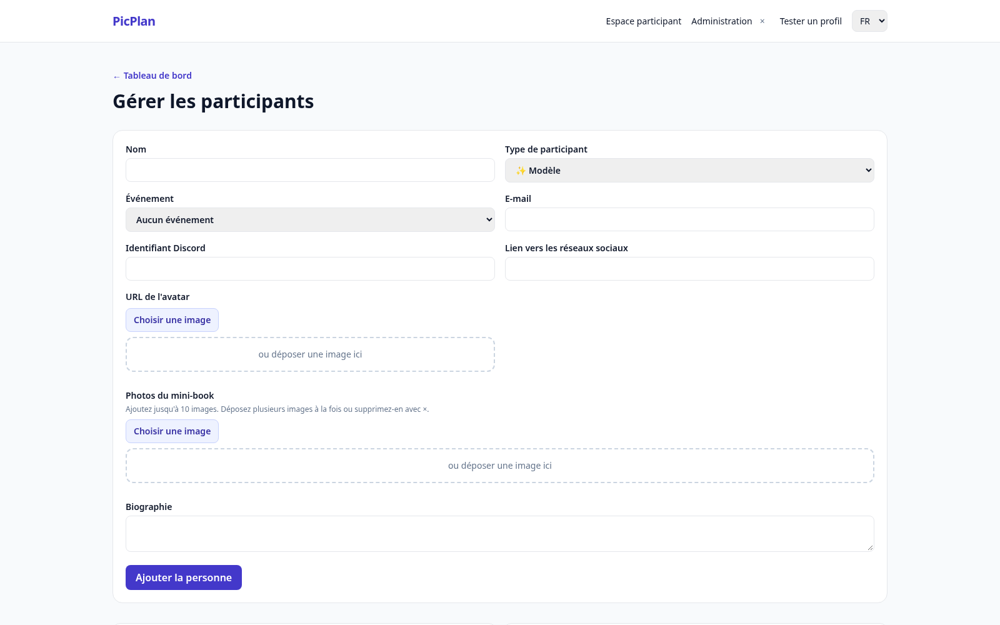

### 4. Associer les profils à l’événement

Depuis **Gérer les événements**, ouvrez le planning de l’événement. Cliquez sur **Associer les profils à l’événement**. Dans la fenêtre qui s’ouvre, cochez les participants et intervenants qui doivent accéder à l’événement, puis cliquez sur **Enregistrer**.

Un intervenant doit être associé à l’événement pour que ses créneaux apparaissent dans le planning. Un participant doit être associé pour consulter l’événement et réserver.

La suppression d’une association est bloquée si le profil possède encore des créneaux ou des réservations pour l’événement. Supprimez ou traitez d’abord ces éléments, selon le message affiché.

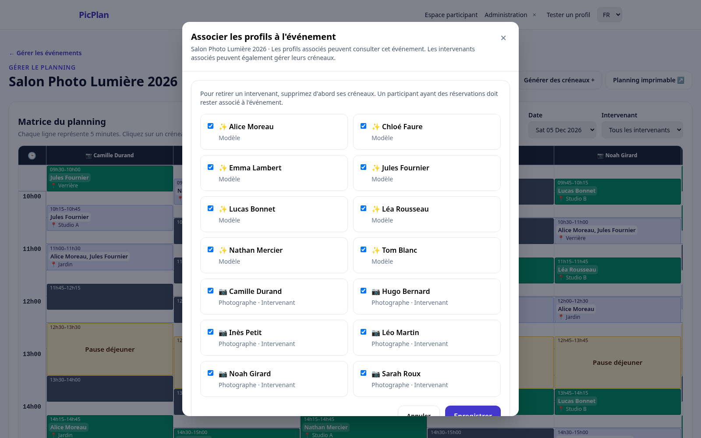

## Créer les lieux et les créneaux

### Ajouter les lieux

Dans **Administration → Gérer les lieux**, sélectionnez l’événement et créez les lieux disponibles pour les rendez-vous. Un participant choisira l’un de ces lieux lorsqu’il demandera un créneau. Vous pouvez aussi ajouter des photos ou un plan du lieu.

Sans lieu associé à l’événement, les participants ne peuvent pas envoyer de demande de réservation.

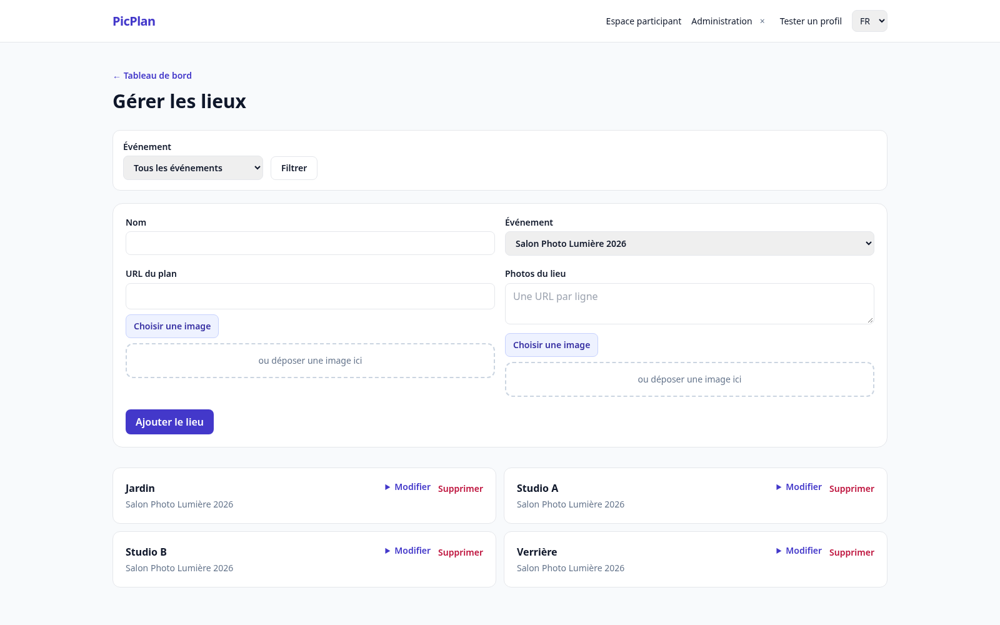

### Générer plusieurs créneaux

Dans **Administration → Générer des créneaux**, choisissez l’événement et un intervenant, puis indiquez :

- la durée de chaque rendez-vous ;
- l’intervalle entre deux rendez-vous ;
- les heures de début et de fin de la journée ;
- les horaires de pause déjeuner, le cas échéant.

La génération crée les créneaux pour les jours de l’événement. Vérifiez le planning après la génération.

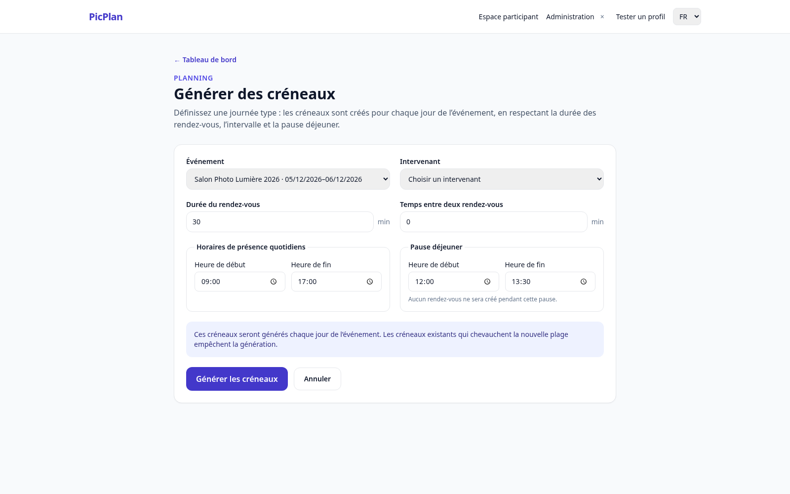

### Ajouter ou modifier un créneau

Depuis le planning administrateur, cliquez sur **Ajouter un créneau** pour créer un créneau individuel. Cliquez sur un créneau existant pour consulter ses réservations et, si vous avez les droits requis, le modifier ou le supprimer.

Un intervenant peut également générer ou gérer ses créneaux depuis **Gérer mon planning**.

Dans la matrice, chaque colonne correspond à un intervenant. Les créneaux verts sont confirmés, les créneaux bleu clair ont des demandes en attente, les créneaux foncés sont libres et les créneaux jaunes sont des pauses déjeuner.

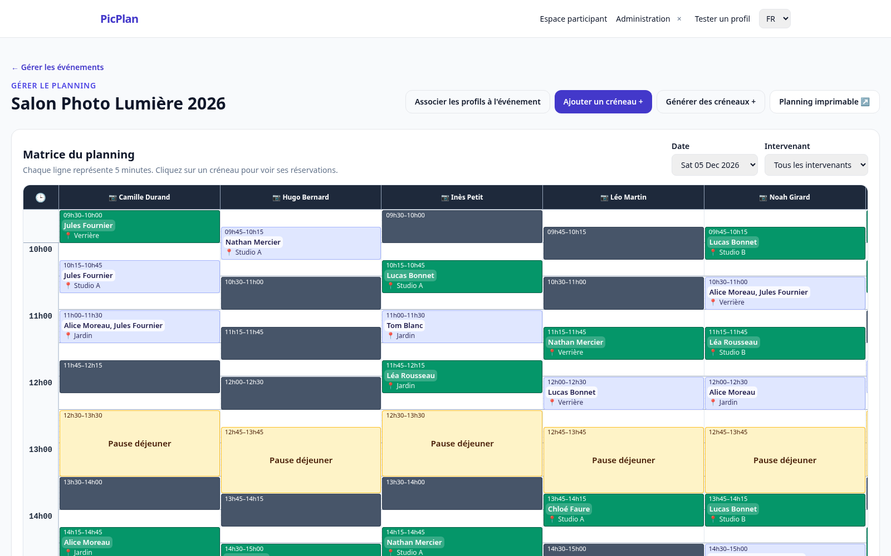

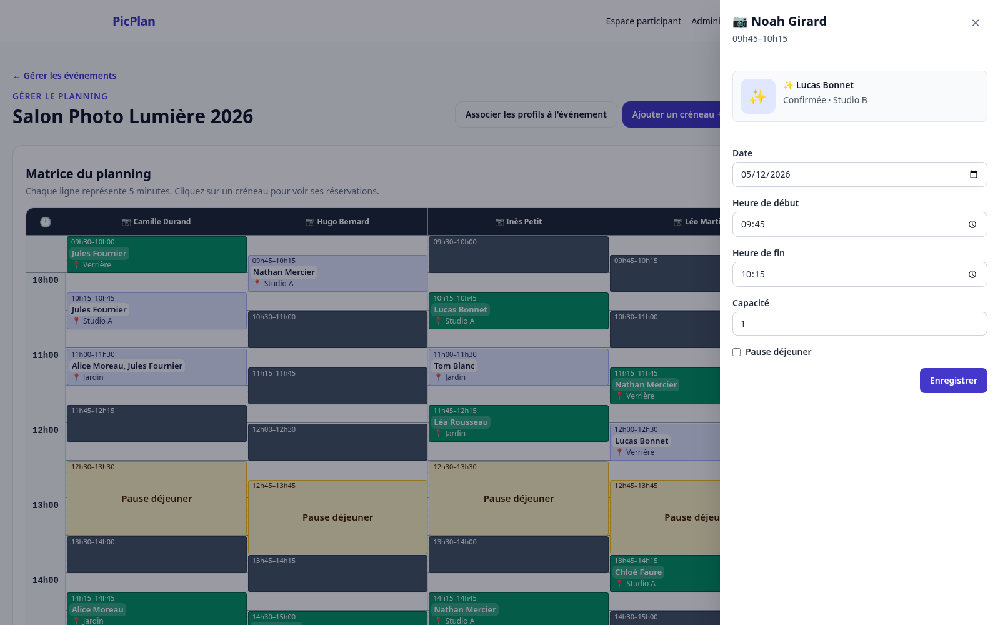

Sur téléphone, la matrice défile horizontalement et verticalement ; les noms des intervenants et les heures restent visibles.

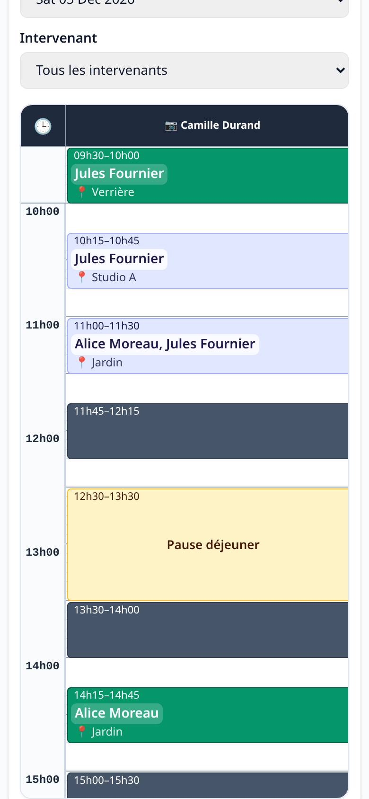

## Réserver un créneau (participant)

1. Connectez-vous avec Discord depuis **Espace participant**.
2. Choisissez un événement, une date et éventuellement un intervenant.
3. Cliquez sur un créneau disponible dans la matrice. Le panneau latéral affiche les informations du créneau et, s’il y en a, les demandes déjà en attente.
4. Choisissez un lieu, puis cliquez sur **Demander ce créneau**.
5. Consultez le statut de la demande dans **Mes réservations**. Une demande en attente n’est pas encore confirmée.

Les demandes sont traitées dans leur ordre d’arrivée. La demande la plus ancienne apparaît en premier. Vous pouvez annuler une demande en attente ou une réservation confirmée depuis **Mes réservations**.

Une demande peut être indisponible si le créneau est complet, déjà confirmé, passé, ou si une limite quotidienne ou une règle de réservation auprès du même intervenant est atteinte.

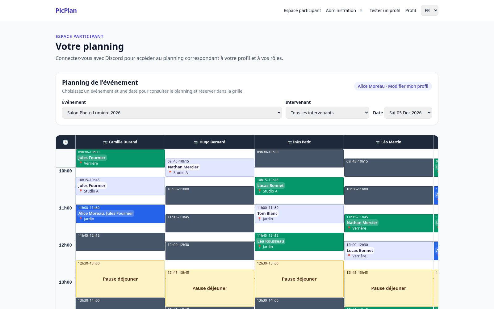

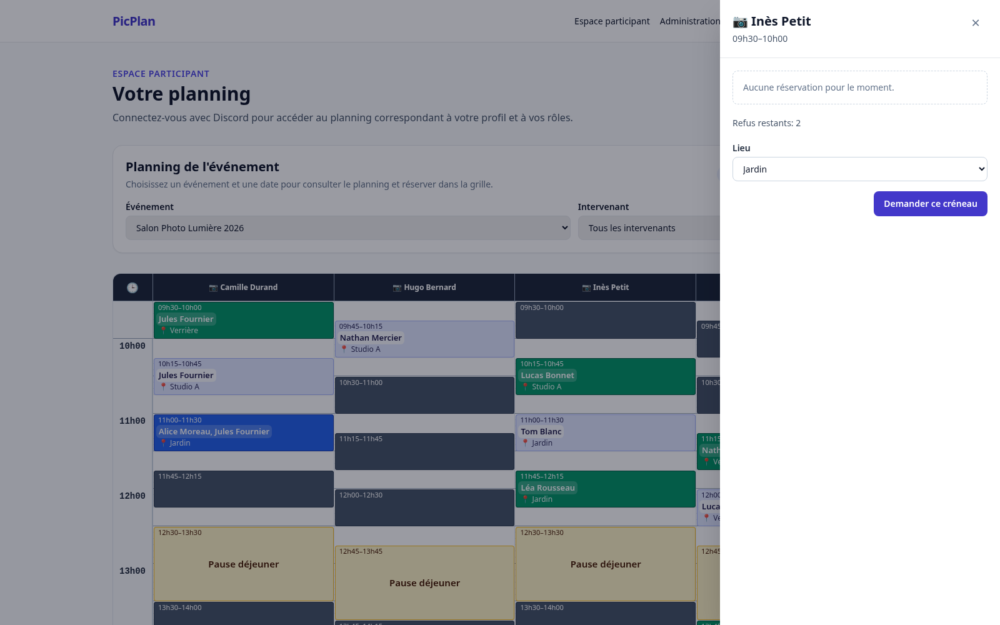

## Traiter les demandes (intervenant)

Ouvrez **Espace participant**, puis **Gérer mon planning**. Choisissez l’événement voulu ; vous pouvez afficher uniquement votre planning ou tous les plannings intervenants si cette option est disponible.

Cliquez sur un créneau pour examiner la file. Les demandes sont classées par ordre d’arrivée : seule la première peut être acceptée ou refusée.

- **Valider** confirme le participant pour le créneau. Un seul participant peut être confirmé. Les autres demandes encore en attente sont alors refusées et les participants en sont informés.
- **Refuser** demande un motif. Le nombre total de refus sur un créneau est plafonné à **la limite de demandes en attente configurée pour l’événement moins un**. Le compteur restant est affiché dans le planning. Lorsque la limite est atteinte, le refus n’est plus disponible.

Les messages privés Discord informent les participants des décisions, si leur compte autorise les messages privés du serveur.

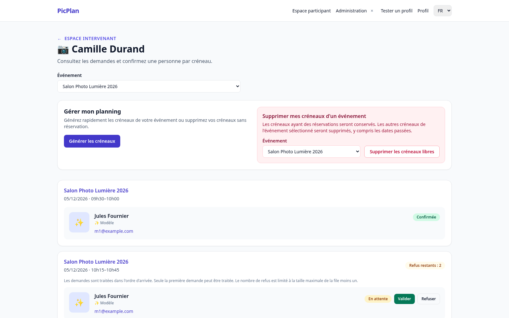

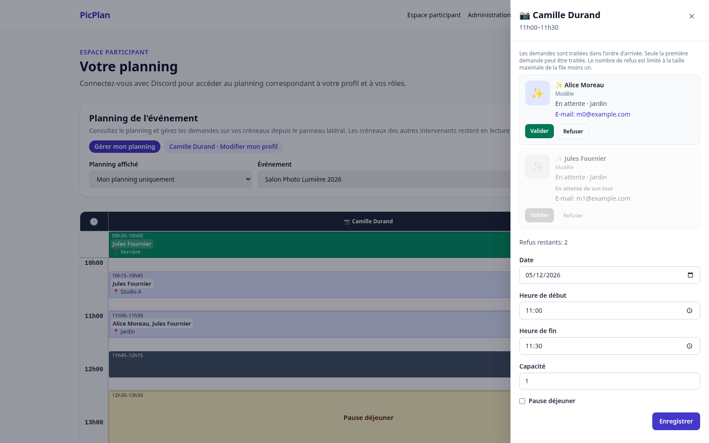

## Modifier son profil

Depuis l’espace participant, cliquez sur votre nom puis sur **Modifier mon profil**. Vous pouvez modifier votre nom, votre identifiant Discord, votre lien social, votre biographie, votre avatar et les photos du mini-book. Le type du profil, l’adresse e-mail et le rôle Discord sont gérés par l’administrateur.

Le mini-book accepte jusqu’à 10 images. Chaque image téléversée peut peser jusqu’à 20 Mo.

## Résoudre les problèmes courants

### Je ne vois pas l’événement

Demandez à l’administrateur de vérifier que votre profil est associé à l’événement et que votre type de profil est correct.

### Discord ne me donne pas accès à mon profil

Vérifiez que l’adresse e-mail vérifiée dans Discord correspond exactement à celle enregistrée sur votre profil PicPlan et que vous possédez le rôle Discord attendu. En cas de doute, contactez l’administrateur.

### Je ne peux pas demander un créneau

Vérifiez que le créneau est disponible, qu’un lieu a été configuré pour l’événement et que vous n’avez pas atteint la limite de réservations quotidienne.

### Je ne peux pas retirer un profil d’un événement

Un profil intervenant ne peut pas être dissocié tant qu’il possède des créneaux pour cet événement. Un profil avec des réservations doit également rester associé. Consultez le message affiché et demandez à l’administrateur de traiter les créneaux ou réservations concernés.

### Je ne reçois pas les messages Discord

Autorisez les messages privés des membres du serveur Discord. Les problèmes de livraison n’annulent pas les demandes ni les décisions prises dans PicPlan.
