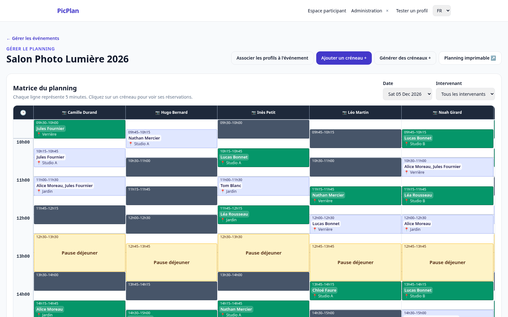
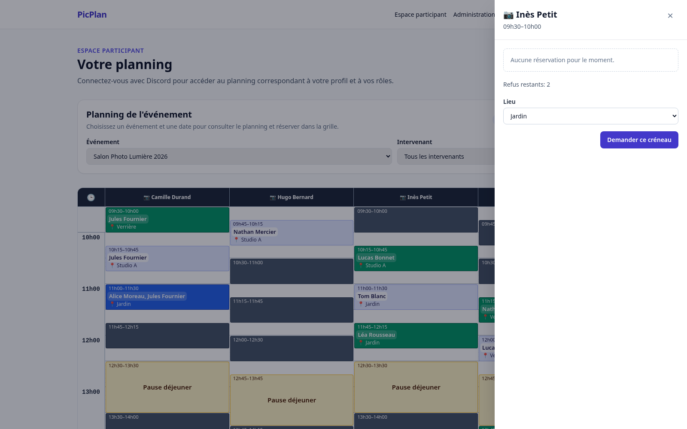
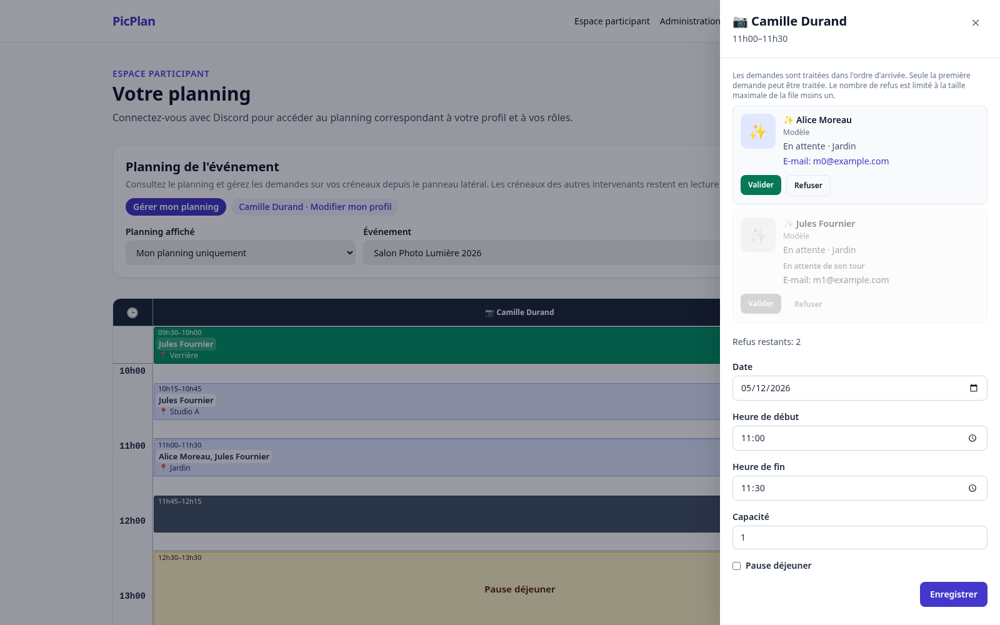
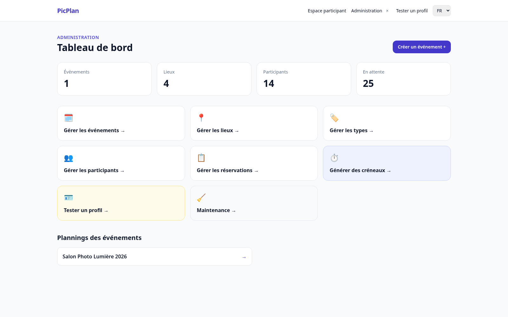
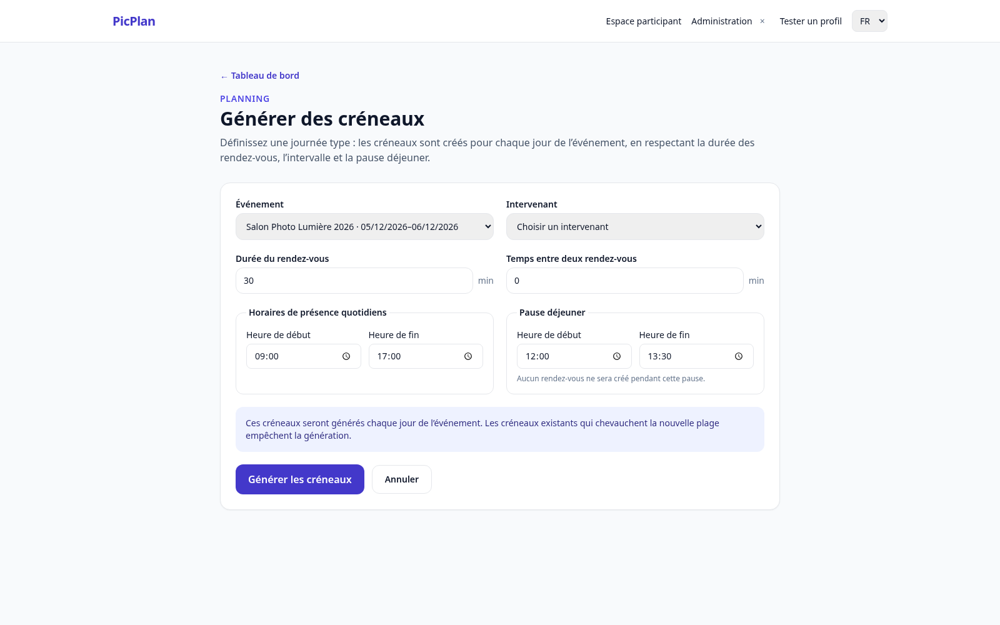
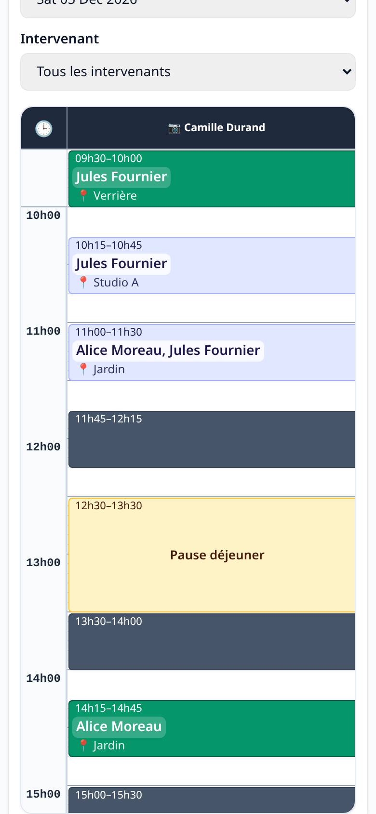

# PicPlan

## English

PicPlan is an event scheduling and booking application built with FastAPI, SQLAlchemy, SQLite, HTMX, and Tailwind CSS. Its interface is available in French and English, with French as the default.

Participants can manage a profile with an avatar and a mini-book of up to 10 photos. Interveners manage their schedules and booking requests. Administrators assign profiles to events; signed-in profiles can only access events to which they are assigned.

Identity is managed through Discord: Discord handles sign-in and role checks for the users who access the app. This project is mostly vibe coded: it is pragmatic and useful for our use case, but it is not a polished, production-grade framework or a reference architecture.

### Quick start with Docker Compose

1. Install Docker Engine and the Docker Compose plugin.
2. From the project directory, create your environment file:

   ```bash
   cp .env.example .env
   ```

3. Edit `.env`. At minimum, set a private `APP_SECRET` and a strong `ADMIN_PASSWORD`. Discord is the app's identity layer, so configure the `DISCORD_*` values if you want sign-in and role checks.
4. Build and start PicPlan:

   ```bash
   sudo docker compose up --build -d
   ```

5. Open <http://127.0.0.1:8000>. Sign in to `/admin/login`, create events and profiles, then use **Administration → Events → Link profiles to event** to assign profiles. New event assignments are not created automatically.

Useful commands:

```bash
sudo docker compose logs -f       # View application logs
sudo docker compose up --build -d # Rebuild and apply code/configuration changes
sudo docker compose down          # Stop the app; keep its data volume
```

Compose runs database migrations automatically before starting the application. SQLite data and uploaded images are stored in the persistent `picplan_data` volume. Back up this volume before moving or replacing an installation; do not remove it when stopping the app.

### Docker deployment notes

For a simple deployment, build locally, copy the image or tarball to the target server, load it there, and keep the same `.env` plus the existing `picplan_data` volume. Do not use `docker compose down -v` during deployment because that deletes the persistent data.

```bash
sudo docker build -t picplan:latest .
sudo docker save -o picplan.tar picplan:latest
scp picplan.tar USER@SERVER_HOST:/tmp/picplan.tar
```

On the server:

```bash
sudo docker load -i /tmp/picplan.tar
sudo docker compose up -d --force-recreate picplan
sudo docker compose logs -f picplan
```

If you use a registry instead of a tarball, keep the image name stable and make sure `docker-compose.yml` uses the built image without the local `build:` section.

### Environment settings

Copy `.env.example` to `.env`. Keep `.env` private and never commit it.

| Variable | Purpose |
| --- | --- |
| `DATABASE_URL` | Database connection. The default is `sqlite:///./data/picplan.db`. |
| `DEFAULT_LANGUAGE` | `fr` or `en`; defaults to French. |
| `APP_ENV` | Use `development` locally or `production` for deployment. |
| `APP_SECRET` | A unique session-signing secret. Generate one with `python -c "import secrets; print(secrets.token_urlsafe(48))"`. |
| `ADMIN_PASSWORD` | Password for the administration account. |
| `UPLOAD_DIR` | Image storage directory; defaults to `./data/uploads`. |
| `DISCORD_CLIENT_ID` | Discord Developer Portal → application → **OAuth2 → General** → Client ID. |
| `DISCORD_CLIENT_SECRET` | Discord Developer Portal → application → **OAuth2 → General** → Client Secret. Keep it private. |
| `DISCORD_BOT_TOKEN` | Discord Developer Portal → application → **Bot** → Token. Keep it private. |
| `DISCORD_GUILD_ID` | Numeric ID of your Discord server. Enable Developer Mode and use **Copy Server ID**. |
| `PUBLIC_BASE_URL` | Public PicPlan origin used in Discord booking links, for example `https://picplan.example`. If empty, PicPlan uses the origin from `DISCORD_REDIRECT_URI`. |
| `DISCORD_REDIRECT_URI` | OAuth callback registered in the Developer Portal. Locally: `http://127.0.0.1:8000/auth/discord/callback`. Use your HTTPS domain in production. |

### Discord sign-in and notifications

1. Create or select an application in the [Discord Developer Portal](https://discord.com/developers/applications), add a bot, and keep its token private.
2. Invite the bot to your server. It must be a server member for role verification and direct-message notifications. Enable **Server Members Intent** if Discord requires it.
3. Register the exact redirect URL in **OAuth2 → General → Redirects**.
4. Set the Discord variables in `.env`. For production, use the HTTPS callback URL of your deployment.
5. In PicPlan administration, set the Discord role ID on each participant type. The account signing in must have the role configured for its profile type.
6. Link participant profiles to events using **Administration → Events → Link profiles to event**.

On first sign-in, PicPlan links the profile using its email and the verified email from Discord. On each successful sign-in, it refreshes the profile's Discord ID and avatar after checking the required server role.

PicPlan sends the intervener a direct message when a booking is requested, and sends the participant a message when the request is approved or rejected. Messages use `DEFAULT_LANGUAGE`. Recipients must allow direct messages from server members. A Discord delivery failure is logged and does not undo a booking or decision.

### Run locally without Docker

```bash
python -m venv .venv
source .venv/bin/activate
pip install -r requirements.txt
cp .env.example .env
# Set APP_SECRET and ADMIN_PASSWORD in .env
set -a
. ./.env
set +a
alembic upgrade head
uvicorn app.main:app --reload
```

Open <http://127.0.0.1:8000>. The local SQLite database is stored at `data/picplan.db`.

### Database migrations

After changing SQLAlchemy models, create and apply a migration:

```bash
alembic revision --autogenerate -m "describe the schema change"
alembic upgrade head
```

Docker Compose applies pending migrations automatically at startup.

### Main pages and features

- Public event list and event schedules
- Schedule matrix with booking controls
- Participant portal for browsing assigned events and managing bookings
- Intervener schedule with booking approval and rejection
- Password-protected administration for events, locations, participant types, profiles, schedules, and bookings
- Per-day printable event schedules
- Slot generation with configurable hours, appointment duration, gaps, and lunch breaks
- Event-specific participant and intervener assignments
- Image uploads for avatars, mini-books, location photos, and floor plans (JPEG, PNG, WebP, JPEG XL, HEIC, or GIF; maximum 20 MB per image)

### Screenshots

Screenshots use demo data. The interface is shown in French, its default language.

**Administrator schedule matrix**: one column per intervener; green slots are confirmed, light blue slots have pending requests, and dark slots are free.



| Booking a slot (participant) | Reviewing requests (intervener) |
|---|---|
|  |  |
| **Administration dashboard** | **Slot generator** |
|  |  |

The schedule matrix also works on phones:



---

## Français

PicPlan est une application de gestion de plannings et de réservations pour des événements. Elle est développée avec FastAPI, SQLAlchemy, SQLite, HTMX et Tailwind CSS. L’interface est disponible en français et en anglais ; le français est la langue par défaut.

Les participants peuvent gérer leur profil, leur avatar et un mini-book de 10 photos maximum. Les intervenants gèrent leurs plannings et les demandes de réservation. Les administrateurs associent les profils aux événements ; une personne connectée ne peut accéder qu’aux événements auxquels son profil est associé.

L’identification est gérée via Discord : le serveur Discord sert à l’authentification et à la vérification des rôles. Le projet est surtout du « vibe coding » : ça marche pour notre usage, mais ce n’est pas un framework produit de qualité industrielle ni une architecture de référence strictement cadrée.

Consultez le [manuel utilisateur en français](./MANUEL-UTILISATEUR.md) pour les consignes détaillées destinées aux administrateurs, participants et intervenants.

### Démarrage rapide avec Docker Compose

1. Installez Docker Engine et le plugin Docker Compose.
2. Depuis le dossier du projet, créez le fichier d’environnement :

   ```bash
   cp .env.example .env
   ```

3. Modifiez `.env`. Définissez au minimum un `APP_SECRET` privé et un `ADMIN_PASSWORD` robuste. Comme l’identification passe par Discord, renseignez aussi les variables `DISCORD_*` pour l’authentification et les rôles.
4. Construisez et démarrez PicPlan :

   ```bash
   sudo docker compose up --build -d
   ```

5. Ouvrez <http://127.0.0.1:8000>. Connectez-vous sur `/admin/login`, créez des événements et des profils, puis associez les profils depuis **Administration → Événements → Associer les profils à l’événement**. Les associations ne sont pas créées automatiquement.

Commandes utiles :

```bash
sudo docker compose logs -f       # Consulter les journaux de l’application
sudo docker compose up --build -d # Reconstruire et appliquer les changements
sudo docker compose down          # Arrêter l’application sans supprimer ses données
```

Compose applique automatiquement les migrations de la base avant de démarrer l’application. La base SQLite et les images téléversées sont conservées dans le volume `picplan_data`. Sauvegardez ce volume avant de déplacer ou remplacer une installation ; ne le supprimez pas lors de l’arrêt.

### Notes de déploiement Docker

Pour un déploiement simple, on construit localement, on copie l’image ou l’archive sur le serveur cible, puis on la charge là-bas en gardant le même `.env` et le volume `picplan_data` existant. N’utilisez pas `docker compose down -v` pendant le déploiement, car cela supprime les données persistantes.

```bash
sudo docker build -t picplan:latest .
sudo docker save -o picplan.tar picplan:latest
scp picplan.tar UTILISATEUR@HOTE_SERVEUR:/tmp/picplan.tar
```

Sur le serveur :

```bash
sudo docker load -i /tmp/picplan.tar
sudo docker compose up -d --force-recreate picplan
sudo docker compose logs -f picplan
```

Si vous utilisez un registre au lieu d’une archive, gardez un nom d’image stable et vérifiez que `docker-compose.yml` pointe vers l’image construite sans section `build:` locale.

### Paramètres d’environnement

Copiez `.env.example` vers `.env`. Gardez ce fichier privé et ne le commitez jamais.

| Variable | Utilisation |
| --- | --- |
| `DATABASE_URL` | Connexion à la base de données. Valeur par défaut : `sqlite:///./data/picplan.db`. |
| `DEFAULT_LANGUAGE` | `fr` ou `en` ; français par défaut. |
| `APP_ENV` | Utilisez `development` en local ou `production` en déploiement. |
| `APP_SECRET` | Secret unique pour signer les sessions. Générez-en un avec `python -c "import secrets; print(secrets.token_urlsafe(48))"`. |
| `ADMIN_PASSWORD` | Mot de passe du compte d’administration. |
| `UPLOAD_DIR` | Dossier de stockage des images ; `./data/uploads` par défaut. |
| `DISCORD_CLIENT_ID` | Discord Developer Portal → application → **OAuth2 → General** → Client ID. |
| `DISCORD_CLIENT_SECRET` | Discord Developer Portal → application → **OAuth2 → General** → Client Secret. Gardez-le privé. |
| `DISCORD_BOT_TOKEN` | Discord Developer Portal → application → **Bot** → Token. Gardez-le privé. |
| `DISCORD_GUILD_ID` | Identifiant numérique du serveur Discord. Activez le mode développeur puis utilisez **Copy Server ID**. |
| `PUBLIC_BASE_URL` | Origine publique de PicPlan utilisée dans les liens Discord, par exemple `https://picplan.example`. Si elle est vide, PicPlan utilise l’origine de `DISCORD_REDIRECT_URI`. |
| `DISCORD_REDIRECT_URI` | URL de callback enregistrée dans le Developer Portal. En local : `http://127.0.0.1:8000/auth/discord/callback`. En production, utilisez votre domaine HTTPS. |

### Connexion et notifications Discord

1. Créez ou sélectionnez une application dans le [Discord Developer Portal](https://discord.com/developers/applications), ajoutez un bot et gardez son jeton privé.
2. Invitez le bot sur votre serveur. Il doit en être membre pour vérifier les rôles et envoyer des messages privés. Activez **Server Members Intent** si Discord l’exige.
3. Enregistrez l’URL exacte de callback dans **OAuth2 → General → Redirects**.
4. Renseignez les paramètres Discord dans `.env`. En production, utilisez l’URL HTTPS de votre déploiement.
5. Dans l’administration PicPlan, configurez l’identifiant Discord sur chaque type de participant. Le compte connecté doit avoir le rôle correspondant au type de son profil.
6. Associez les profils aux événements depuis **Administration → Événements → Associer les profils à l’événement**.

Lors de la première connexion, PicPlan associe le profil à partir de son adresse e-mail et de l’adresse vérifiée par Discord. À chaque connexion réussie, PicPlan actualise l’identifiant Discord et l’avatar du profil après avoir vérifié le rôle requis sur le serveur.

Lorsqu’une réservation est demandée, l’intervenant reçoit un message privé. Le participant reçoit un message lorsque sa demande est acceptée ou refusée. Les messages suivent `DEFAULT_LANGUAGE`. Les destinataires doivent autoriser les messages privés des membres du serveur. Un échec d’envoi est journalisé et n’annule pas la réservation ou la décision.

### Exécution locale sans Docker

```bash
python -m venv .venv
source .venv/bin/activate
pip install -r requirements.txt
cp .env.example .env
# Définissez APP_SECRET et ADMIN_PASSWORD dans .env
set -a
. ./.env
set +a
alembic upgrade head
uvicorn app.main:app --reload
```

Ouvrez <http://127.0.0.1:8000>. La base SQLite locale se trouve dans `data/picplan.db`.

### Migrations de la base de données

Après une modification des modèles SQLAlchemy, créez et appliquez une migration :

```bash
alembic revision --autogenerate -m "describe the schema change"
alembic upgrade head
```

Docker Compose applique automatiquement les migrations en attente au démarrage.

### Pages et fonctionnalités principales

- Liste publique des événements et plannings
- Matrice des plannings avec commandes de réservation
- Espace participant pour parcourir les événements associés et gérer ses réservations
- Planning intervenant avec validation et refus des demandes
- Administration protégée par mot de passe pour les événements, lieux, types de profils, profils, plannings et réservations
- Vue imprimable des plannings, une page par jour
- Génération de créneaux avec horaires, durée, intervalles et pause déjeuner configurables
- Association des participants et intervenants à chaque événement
- Téléversement d’avatars, de mini-books, de photos de lieux et de plans (JPEG, PNG, WebP, JPEG XL, HEIC ou GIF ; 20 Mo maximum par image)

### Captures d’écran

Les captures utilisent des données de démonstration.

**Matrice du planning administrateur** : une colonne par intervenant ; les créneaux verts sont confirmés, les bleu clair ont des demandes en attente et les foncés sont libres.


| Réserver un créneau (participant) | Traiter les demandes (intervenant) |
|---|---|
|  |  |
| **Tableau de bord d’administration** | **Génération de créneaux** |
|  |  |

La matrice du planning fonctionne aussi sur téléphone :


Le [manuel utilisateur](./MANUEL-UTILISATEUR.md) contient d’autres captures pour chaque étape.
